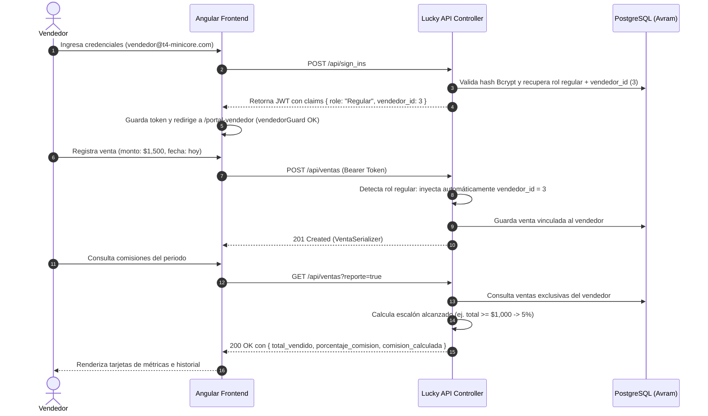

# T4-Minicore: Sistema de Cálculo de Comisiones por Ventas (MVC + RBAC)


**Plataforma web empresarial para el registro transaccional de ventas y liquidación escalonada de comisiones comerciales.**  
Construida bajo el patrón arquitectónico **Modelo-Vista-Controlador (MVC)** desacoplado con **Control de Acceso Basado en Roles (RBAC)**.

---

## 📑 Tabla de Contenidos

1. [✨ Características Destacadas](#-características-destacadas)
2. [🔑 Credenciales de Acceso y Roles](#-credenciales-de-acceso-y-roles)
3. [🏛️ Arquitectura MVC Desacoplada](#️-arquitectura-mvc-desacoplada)
4. [🔄 Flujo Operativo y Matriz RBAC](#-flujo-operativo-y-matriz-rbac)
5. [📱 Diseño Adaptativo (Responsive Service)](#-diseño-adaptativo-responsive-service)
6. [🛠️ Tecnologías Utilizadas (Tech Stack)](#️-tecnologías-utilizadas-tech-stack)
7. [📁 Estructura del Repositorio](#-estructura-del-repositorio)
8. [🚀 Instalación y Puesta en Marcha Local](#-instalación-y-puesta-en-marcha-local)
9. [☁️ Despliegue en la Nube con Render (Full-Stack)](#️-despliegue-en-la-nube-con-render-full-stack)
10. [🌐 Matriz de Endpoints REST API](#-matriz-de-endpoints-rest-api)
11. [👩‍💻 Autora y Contacto](#-autora-y-contacto)

---

## ✨ Características Destacadas

* **👑 Panel Exclusivo de Administración (`/admin`):**
  - **Gestión de Vendedores:** alta, consulta, modificación y baja de personal de ventas.
  - **Reglas Escalonadas de Comisión:** definición dinámica de metas de venta y porcentajes de incentivo aplicados.
  - **Reporte Consolidado Global:** auditoría por rango de fechas que calcula el total vendido y la comisión devengada por cada asesor comercial.
* **💼 Portal Personal del Vendedor (`/portal-vendedor`):**
  - **Registro Seguro de Ventas:** registro de transacciones con monto y fecha; el backend asigna automáticamente la autoría a partir del token JWT del vendedor autenticado.
  - **Cálculo de Comisión en Tiempo Real:** consulta de monto acumulado vendido, porcentaje alcanzado en las escalas y comisión neta ganada en el periodo.
  - **Historial Transaccional:** auditoría de ventas individuales registradas por el usuario en sesión.
* **🛡️ Seguridad de Doble Capa (Client & Server RBAC):**
  - En cliente: guards funcionales de Angular ([`authGuard`](t4-minicore-web/src/app/core/guards/auth.guard.ts), [`adminGuard`](t4-minicore-web/src/app/core/guards/admin.guard.ts), [`vendedorGuard`](t4-minicore-web/src/app/core/guards/vendedor.guard.ts)).
  - En servidor: filtros antes de acción (`require_admin`, `require_admin_or_vendedor`) y aislamiento a nivel de consulta en base de datos.
* **📱 Adaptabilidad Móvil y Tema Claro (Light Theme):**
  - Interfaz responsiva con diseño limpio, tablas completas en escritorio y tarjetas de inspección rápida en dispositivos móviles gracias a Angular CDK Layout.

---

## 🔑 Credenciales de Acceso y Roles

El sistema cuenta con usuarios de prueba sembrados en la base de datos con contraseñas encriptadas mediante **Bcrypt**:

| Rol del Sistema | Correo Electrónico | Contraseña | Destino en Login | Permisos y Alcance |
| :--- | :--- | :--- | :--- | :--- |
| **👑 Administrador** | `admin@t4-minicore.com` | `password123` | [`/admin`](t4-minicore-web/src/app/pages/admin/admin.ts) | Control total: gestión de vendedores, reglas comerciales, reporte consolidado global y administración de usuarios (`/users`). |
| **💼 Vendedor** | `vendedor@t4-minicore.com` | `password123` | [`/portal-vendedor`](t4-minicore-web/src/app/pages/portal-vendedor/portal-vendedor.ts) | Operativa comercial: registrar ventas propias, auditar comisiones ganadas e historial personal (ID de Vendedor asociado: #3). |

---

## 🏛️ Arquitectura MVC Desacoplada

La solución aplica el patrón **Modelo-Vista-Controlador** de manera estricta y desacoplada:

```mermaid
flowchart LR
    subgraph ViewLayer["👁️ VISTA (Angular SPA - Light Theme)"]
        LoginUI["Login (/login)"]
        AdminUI["Panel Admin (/admin)"]
        SellerUI["Portal Vendedor (/portal-vendedor)"]
    end

    subgraph ControllerLayer["🎮 CONTROLADOR (Lucky Actions)"]
        AuthAction["Api::SignIns::Create"]
        VendAction["Api::Vendedor::* (require_admin)"]
        ReglaAction["Api::Regla::* (require_admin)"]
        VentaAction["Api::Ventas::* (RBAC Guard)"]
    end

    subgraph ModelLayer["🧠 MODELO (Avram ORM & PostgreSQL)"]
        UserModel["User & UserToken"]
        VendModel["Vendedor (has_many Ventas)"]
        ReglaModel["Regla (Escalones)"]
        VentaModel["Venta (belongs_to Vendedor)"]
    end

    ViewLayer <-->|Peticiones HTTP REST + JWT| ControllerLayer
    ControllerLayer <-->|Consultas Seguras & Serializers| ModelLayer
```



| Capa MVC | Responsable Tecnológico | Módulos Clave | Función en el Sistema |
| :--- | :--- | :--- | :--- |
| **🧠 Modelo** | **Avram ORM** *(Crystal)* | [`User`](t4-minicore-api/src/models/user.cr), [`Vendedor`](t4-minicore-api/src/models/vendedor.cr), [`Regla`](t4-minicore-api/src/models/regla.cr), [`Venta`](t4-minicore-api/src/models/venta.cr) | Define la estructura de datos, claves foráneas, validaciones de negocio en SaveOperations y el hashing unidireccional con Bcrypt. |
| **🎮 Controlador** | **Lucky Actions** *(Crystal)* | `Api::SignIns::Create`, `Api::Vendedor::*`, `Api::Regla::*`, `Api::Ventas::*` | Enruta peticiones HTTP, verifica tokens JWT, aplica filtros de autorización según rol y serializa la respuesta JSON. |
| **👁️ Vista** | **Angular SPA & Serializers** | [`Login`](t4-minicore-web/src/app/pages/login/login.ts), [`Admin`](t4-minicore-web/src/app/pages/admin/admin.ts), [`PortalVendedor`](t4-minicore-web/src/app/pages/portal-vendedor/portal-vendedor.ts) | Interfaz de usuario reactiva en tema claro con señales (Signals), adaptativa a cualquier tamaño de pantalla. |

---

## 🔄 Flujo Operativo y Matriz RBAC



---

## 📱 Diseño Adaptativo (Responsive Service)

La aplicación utiliza un servicio centralizado reactivo basado en `@angular/cdk/layout`:

```typescript
// src/app/core/services/responsive.service.ts
@Injectable({ providedIn: 'root' })
export class ResponsiveService {
  private breakpointObserver = inject(BreakpointObserver);
  private screenWidth = toSignal(
    this.breakpointObserver.observe([
      '(max-width: 600px)',
      '(min-width: 601px) and (max-width: 1000px)',
      '(min-width: 1001px)'
    ])
  );

  isMobile = computed(() => !!this.screenWidth()?.breakpoints['(max-width: 600px)']);
  isTablet = computed(() => !!this.screenWidth()?.breakpoints['(min-width: 601px) and (max-width: 1000px)']);
  isDesktop = computed(() => !!this.screenWidth()?.breakpoints['(min-width: 1001px)']);
}
```

* **Modo Escritorio (`isDesktop`):** Tablas de datos completas, paneles en dos columnas y controles alineados horizontalmente.
* **Modo Móvil (`isMobile`):** Conversión automática a tarjetas compactas individuales (`.cards-list`), formularios apilados verticalmente y botones de acción accesibles.

---

## 🛠️ Tecnologías Utilizadas (Tech Stack)

### Backend
* **[Crystal Language](https://crystal-lang.org/):** Lenguaje compilado fuertemente tipado con rendimiento cercano a C.
* **[Lucky Framework v1.5](https://luckyframework.org/):** Framework MVC rápido y seguro contra errores en tiempo de compilación.
* **[Avram ORM](https://github.com/luckyframework/avram):** Manejo de entidades, migraciones y consultas SQL seguras.
* **[Authentic](https://github.com/luckyframework/authentic):** Hashing seguro de contraseñas con **Bcrypt** y generación de JWT.

### Frontend
* **[Angular v22](https://angular.dev/):** Framework empresarial SPA.
* **Angular Signals:** Gestión de estado reactivo y granular.
* **Angular CDK Layout:** Detección de breakpoints para comportamiento responsivo.
* **Angular Router & Guards:** Control de navegación perimetral.
* **CSS3 Simple (Light Theme):** Paleta moderna basada en blanco (`#ffffff`), grises suaves (`#f8fafc`, `#e2e8f0`) y verde azulado corporativo (`#0d9488`).

### Base de Datos
* **[PostgreSQL](https://www.postgresql.org/):** Motor relacional con integridad referencial y claves foráneas.

---

## 📁 Estructura del Repositorio

```text
t4-minicore/
├── t4-minicore-api/                     # ⚙️ Backend en Lucky Framework (Crystal)
│   ├── config/                          # Configuración de base de datos, cookies y tokens
│   ├── db/
│   │   ├── migrations/                  # Migraciones estructurales (Users, Vendedores, Ventas, Reglas)
│   │   └── seed/                        # Semillas con datos iniciales (sample_data.cr)
│   └── src/
│       ├── actions/                     # 🎮 Controladores
│       │   ├── api_action.cr            # Control base con require_admin y require_vendedor
│       │   └── api/
│       │       ├── sign_ins/create.cr   # Endpoint de autenticación (JWT)
│       │       ├── vendedor/            # CRUD REST de vendedores (Solo Admin)
│       │       ├── regla/               # CRUD REST de reglas de comisión (Solo Admin)
│       │       ├── ventas/              # Registro y reporte de comisiones (Admin y Vendedor)
│       │       └── users/               # CRUD de usuarios del sistema
│       ├── models/                      # 🧠 Modelos Avram
│       │   ├── user.cr                  # Usuario con rol y vendedor_id foráneo
│       │   ├── vendedor.cr              # Entidad vendedor vinculada a ventas y usuario
│       │   ├── venta.cr                 # Registro de transacción comercial
│       │   └── regla.cr                 # Escalones de monto mínimo y porcentaje
│       ├── operations/                  # Operaciones de guardado y validaciones
│       └── serializers/                 # Serializadores JSON (ComisionSerializer, VendedorSerializer, etc.)
│
├── t4-minicore-web/                      # 🎨 Frontend en Angular 22 (SPA)
│   └── src/app/
│       ├── core/
│       │   ├── guards/                  # Protecciones de ruta (authGuard, adminGuard, vendedorGuard)
│       │   ├── interceptors/            # Inyección de Bearer Token en peticiones HTTP
│       │   └── services/                # AuthService, ComisionesService, VendedorService, ReglaService, ResponsiveService
│       ├── pages/                       # Vistas de la aplicación
│       │   ├── login/                   # Inicio de sesión con redirección por rol
│       │   ├── admin/                   # Panel de administración (vendedores, reglas y reporte global)
│       │   ├── portal-vendedor/         # Portal del vendedor (registrar venta y mis comisiones)
│       │   └── users/                   # Gestión de usuarios
│       └── shared/models/               # Modelos e interfaces TypeScript
│
└── README.md                            # Documentación integral del sistema
```

---

## 🚀 Instalación y Puesta en Marcha Local

### Prerrequisitos
- **Crystal** `>= 1.10.0` y **Lucky CLI**
- **Node.js** `>= 18.x` y **npm**
- **PostgreSQL** `>= 14.x` en ejecución local

---

### Paso 1: Clonar el Repositorio
```bash
git clone git@github.com:SaraChiriboga/t4-minicore.git
cd t4-minicore
```

---

### Paso 2: Configurar y Levantar el Backend (`t4-minicore-api`)

1. Ingresar a la carpeta de la API:
   ```bash
   cd t4-minicore-api
   ```
2. Instalar dependencias de Crystal:
   ```bash
   shards install
   ```
3. Configurar variables de base de datos en `.env` (si es necesario):
   ```bash
   DB_HOST=localhost
   DB_PORT=5432
   DB_USER=lucky
   DB_PASSWORD=lucky
   ```
4. Crear la base de datos y correr las migraciones:
   ```bash
   lucky db.create
   lucky db.migrate
   ```
5. Cargar las semillas de prueba (vendedores, ventas, reglas y usuarios de acceso):
   ```bash
   crystal run db/seed/sample_data.cr
   ```
6. Iniciar el servidor API (puerto `3000`):
   ```bash
   lucky dev
   # o directamente:
   crystal run src/t4_minicore_api.cr
   ```

---

### Paso 3: Configurar y Levantar el Frontend (`t4-minicore-web`)

1. Abrir una nueva terminal y navegar a la carpeta web:
   ```bash
   cd t4-minicore-web
   ```
2. Instalar dependencias de Node:
   ```bash
   npm install
   ```
3. Compilar y levantar la aplicación de desarrollo:
   ```bash
   ng serve
   ```
4. Ingresar desde el navegador web:
   ```
   http://localhost:4200
   ```

---

## ☁️ Despliegue en la Nube con Render (Full-Stack)

El repositorio incluye soporte nativo para **[Render](https://render.com/)** mediante contenedores Docker para el backend y hosting estático para el frontend.

### 🌟 Opción 1: Despliegue Automático mediante Blueprint (Recomendada)

1. Sube los cambios más recientes a tu repositorio de GitHub:
   ```bash
   git push origin main
   ```
2. Inicia sesión en **[dashboard.render.com](https://dashboard.render.com/)**.
3. Haz clic en **New +** y selecciona **Blueprint**.
4. Conecta tu repositorio `t4-minicore`.
5. Render detectará automáticamente el archivo [`render.yaml`](render.yaml) y provisionará:
   - 🗄️ **Base de datos PostgreSQL:** `t4-minicore-db`
   - ⚙️ **Web Service (API en Docker):** `t4-minicore-api` (ejecuta migraciones y semillas automáticamente al arrancar)
   - 🌐 **Static Site (Angular):** `t4-minicore-web` (con redirección SPA `/index.html`)
6. Haz clic en **Apply** para iniciar el despliegue de toda la infraestructura.

---

### 🛠️ Opción 2: Despliegue Manual Paso a Paso

Si prefieres crear los servicios manualmente en la interfaz de Render:

#### 1. Crear la Base de Datos PostgreSQL
* Ve a **New +** > **PostgreSQL**.
* **Name:** `t4-minicore-db`
* **Database:** `t4_minicore_api_production`
* **User:** `lucky`
* **Plan:** Free
* Guarda el servicio y copia el **Internal Database URL** generado.

#### 2. Desplegar el Backend (`t4-minicore-api`)
* Ve a **New +** > **Web Service**.
* Conecta tu repositorio `t4-minicore`.
* **Root Directory:** `t4-minicore-api`
* **Runtime:** `Docker`
* **Dockerfile Path:** `Dockerfile`
* **Instance Type:** Free
* En la sección **Environment Variables**, añade:
  * `LUCKY_ENV`: `production`
  * `PORT`: `3000`
  * `DATABASE_URL`: Pega el *Internal Database URL* de tu base de datos de Render.
  * `SECRET_KEY_BASE`: Genera un valor seguro (ej. con `lucky gen.secret_key` o cadena alfanumérica de 32+ caracteres).
* Haz clic en **Create Web Service**. El contenedor compilará, correrá las migraciones y sembrará los usuarios y reglas iniciales.
* Copia la URL pública generada (ej. `https://t4-minicore-api.onrender.com`).

#### 3. Desplegar el Frontend (`t4-minicore-web`)
* Ve a **New +** > **Static Site**.
* Conecta tu repositorio `t4-minicore`.
* **Root Directory:** `t4-minicore-web`
* **Build Command:** `npm install && npm run build`
* **Publish Directory:** `dist/t4-minicore-web/browser`
* En **Redirects/Rewrites**:
  * **Type:** `Rewrite`
  * **Source:** `/*`
  * **Destination:** `/index.html`
* En `src/environments/environment.prod.ts`, coloca la URL pública asignada a tu backend API en Render.
* Haz clic en **Create Static Site**.

---

## 🌐 Matriz de Endpoints REST API

| Módulo | Método | Endpoint | Permiso Requerido | Descripción |
| :--- | :--- | :--- | :--- | :--- |
| **Auth** | `POST` | `/api/sign_ins` | Público | Autentica credenciales y emite token JWT con rol. |
| **Vendedor** | `GET` | `/api/vendedor` | Admin | Lista todos los vendedores. |
| **Vendedor** | `POST` | `/api/vendedor` | Admin | Crea un nuevo vendedor. |
| **Vendedor** | `PUT` | `/api/vendedor/:id` | Admin | Modifica datos del vendedor. |
| **Vendedor** | `DELETE` | `/api/vendedor/:id` | Admin | Elimina un vendedor. |
| **Reglas** | `GET` | `/api/regla` | Admin | Lista los escalones de comisión. |
| **Reglas** | `POST` | `/api/regla` | Admin | Crea una nueva regla de comisión. |
| **Reglas** | `PUT` | `/api/regla/:id` | Admin | Actualiza una regla existente. |
| **Reglas** | `DELETE` | `/api/regla/:id` | Admin | Elimina una regla. |
| **Ventas** | `POST` | `/api/ventas` | Admin o Vendedor | Registra venta. Vendedor auto-asigna su ID; Admin puede asignar cualquiera. |
| **Ventas** | `GET` | `/api/ventas` | Admin o Vendedor | Lista ventas. Si es Vendedor, aísla solo sus transacciones. |
| **Reporte** | `GET` | `/api/ventas?reporte=true` | Admin o Vendedor | Calcula comisiones según fechas y reglas. Vendedor ve solo su ganancia. |
| **Usuarios** | `*` | `/api/users/**` | Admin | CRUD integral de cuentas de acceso. |

---

## 👩‍💻 Autora y Contacto

<div align="center">

### Sara Chiriboga
*Estudiante de Ingeniería de Software · Universidad de las Américas*

[](https://www.linkedin.com/in/sara-chiriboga-112bb33ba)
[](https://github.com/sarilola)
[](https://github.com/SaraChiriboga)
[](https://discordapp.com/users/1141563506152448090)

💬 *¿Dudas o comentarios sobre la arquitectura o implementación? ¡Conectemos!*

</div>
